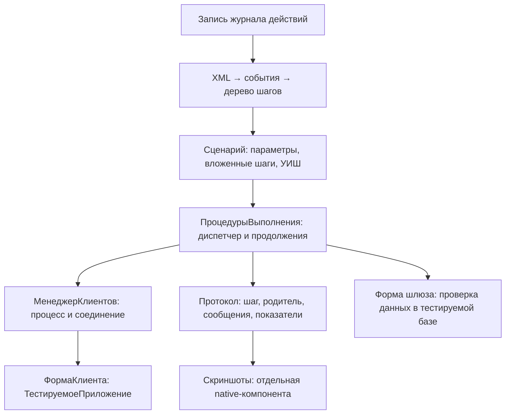

# 1С:Сценарное тестирование и 1С:Тестировщик — анализ для Toolkit

Дата: 15.11.2026. Исследованы предоставленные пользователем XML/BSL-выгрузки. Цель — собрать кандидатов для развития тестирования Toolkit; выбор внедрения остаётся за последующим общим сравнением. Изменений исполняемого кода и статусов задач нет.

## Главное

Самая полезная добавка к нашему текущему драйверу — **сверки с эталонами, диагностические показатели по шагам, импорт записи в проверяемое представление сценария и расширение испытательных форм**. Асинхронное ожидание, строгая уникальность цели и проверка значения после ввода уже реализованы в Toolkit; здесь полезны варианты поведения и проверочные случаи, а не замена нашей реализации.

Доказательства решения устойчивой идентичности одинаковых строк и capability карточки-гиперссылки в рассмотренных путях не получены. Исследование не закрывает эти пункты и не возобновляет отложенное внедрение клиентского адаптера.

## 1. Что именно сравнивалось

| Источник | Подтверждено Configuration.xml | Размер |
| --- | --- | --- |
| [СценарноеТестирование](C:/1C/ref/СТ_Т/СТ__3_0_40_7/cf/Configuration.xml:55) | 3.0.40.7; режим совместимости Version8_3_24 | 1068 BSL-файлов во всей выгрузке |
| [Тестировщик](C:/1C/ref/СТ_Т/Т__1_0_10_34/cf/Configuration.xml:52) | 1.0.10.34; режим совместимости Version8_3_12 | 102 BSL-файла во всей выгрузке |

Режим совместимости конфигурации не является доказательством минимальной версии платформы для всех путей исполнения. Сборка и запуск не выполнялись.

В обеих выгрузках обработка `СценарноеТестированиеИнтерактивныхДействий` содержит **95 BSL-модулей: 92 совпадают SHA-256, 3 различаются; BSL-файлов, присутствующих только в одной версии обработки, нет**. Это сравнение BSL данной обработки, а не равенство двух конфигураций, XML-форм или встроенных бинарных макетов.

[Манифест источников](evidence/1c-testing-donors/source-manifest.json) содержит пути, SHA-256 и число строк 196 файлов: обе Configuration.xml, оба набора по 95 BSL и четыре модуля форм самопроверки Тестировщика. Контрольные суммы позволяют обнаружить последующее изменение предоставленных выгрузок.

Основной разбор выполнен на Сценарном тестировании, одинаковые модули относятся и к Тестировщику. Три отличающихся модуля сравнены отдельно. Прочитаны целевые процедуры, а не все 1068 модулей большой конфигурации. BSL исследован через RLM с файловым доступом; готовых индексов нет, новые индексы не создавались.

Официальные страницы используются только для описания назначения: [Сценарное тестирование](https://v8.1c.ru/tekhnologii/tekhnologii-krupnykh-vnedreniy/korporativnye-instrumenty/korporativnyy-instrumentalnyy-paket/1c-stsenarnoe-testirovanie/) охватывает проектирование, выполнение и анализ тестов; [Тестировщик](https://v8.1c.ru/tekhnologii/tekhnologii-krupnykh-vnedreniy/korporativnye-instrumenty/korporativnyy-instrumentalnyy-paket/1c-testirovshchik/) предназначен для обучения и простых случаев. Заявленная совместимость сценариев не подменяет проверку конкретного импортера.

## 2. Устройство исследованного ядра

Это схема прочитанных связей, не полная архитектура корпоративного продукта. Планирование пакетов, права большой конфигурации и серверный исполнитель внутри встроенного EPF здесь полностью не исследованы.

## 3. Находки и условия использования

### SCT-01. Запись действий и промежуточное дерево сценария — F-11, F-12, F-22

[Начало записи](C:/1C/ref/СТ_Т/СТ__3_0_40_7/cf/DataProcessors/СценарноеТестированиеИнтерактивныхДействий/Forms/РаботаСЖурналомДействийПользователя/Ext/Form/Module.bsl:213) вызывает штатный `НачатьЗаписьЖурналаДействийПользователя()`; остановка, строки 102–137, получает XML через `ЗавершитьЗаписьЖурналаДействийПользователя()`. Есть выход в журнал, последовательность шагов или текст процедуры.

[Преобразование событий](C:/1C/ref/СТ_Т/СТ__3_0_40_7/cf/DataProcessors/СценарноеТестированиеИнтерактивныхДействий/Forms/РаботаСЖурналомДействийПользователя/Ext/Form/Module.bsl:380) сначала строит последовательность узлов XML, затем ведёт стек описателей объектов, группы форм и таблиц и добавляет типизированные шаги. Отдельная нормализация временных шагов заполнения, строки 528–621, различает поле формы, несколько реквизитов, колонку и строку таблицы. УИШ относится к шагу сценария, а не к физической строке данных.

Для Toolkit: возможный импорт записи в ограниченный набор наших команд, с сохранением исходного события, критериев цели, параметров и места в дереве. Исполняемые BSL-шаги должны оставаться отдельной capability; импорт не должен автоматически разрешать произвольный код. На каждом запуске цели нужно разрешать заново в текущем session_id.

Критическое отличие двух стадий:
- При неизвестной записанной команде конвертер добавляет сообщение об ошибке: [накопитель ошибок](C:/1C/ref/СТ_Т/СТ__3_0_40_7/cf/DataProcessors/СценарноеТестированиеИнтерактивныхДействий/Forms/РаботаСЖурналомДействийПользователя/Ext/Form/Module.bsl:1938), ветка 1058–1065. Сам факт сообщения ещё не доказывает, что частичный импорт запрещён.
- При неизвестном **типе готового шага** диспетчер пишет сообщение, но передаёт `Истина` в заключительные операции: [диспетчер](C:/1C/ref/СТ_Т/СТ__3_0_40_7/cf/DataProcessors/СценарноеТестированиеИнтерактивныхДействий/Forms/ПроцедурыВыполнения/Ext/Form/Module.bsl:466), строки 607–611.

Новый кандидат F-22: до исполнения проверять версию формата, все типы шагов, доступные возможности и политику продолжения. Неизвестный шаг отклонять; исходный сценарий сохранять. Это дополнение к F-11, а не второй исполнитель.

### SCT-02. Ожидания с продолжениями — уточнение F-08

[НачатьУстановкуСоединения](C:/1C/ref/СТ_Т/СТ__3_0_40_7/cf/DataProcessors/СценарноеТестированиеИнтерактивныхДействий/Forms/МенеджерКлиентов_КлиентТестирования/Ext/Form/Module.bsl:623) хранит предел ожидания и callback, первая проверка запланирована через 5 секунд. [ПроверитьРезультатУстановкиСоединения](C:/1C/ref/СТ_Т/СТ__3_0_40_7/cf/DataProcessors/СценарноеТестированиеИнтерактивныхДействий/Forms/МенеджерКлиентов_КлиентТестирования/Ext/Form/Module.bsl:3045) повторяет допустимые ошибки через одноразовый обработчик через 1 секунду; после Connect отдельно проверяет доступность окон. Отмена ожидания предусмотрена отдельным методом.

[Проверка формы](C:/1C/ref/СТ_Т/СТ__3_0_40_7/cf/DataProcessors/СценарноеТестированиеИнтерактивныхДействий/Forms/ПроцедурыВыполнения/Ext/Form/Module.bsl:4431) сохраняет время начала, выполняет проверочное действие и при необходимости планирует продолжение. [ПовторныйВызовСледующегоШага](C:/1C/ref/СТ_Т/СТ__3_0_40_7/cf/DataProcessors/СценарноеТестированиеИнтерактивныхДействий/Forms/Сценарий/Ext/Form/Module.bsl:10092) обновляет индикацию и подключает одноразовый обработчик.

Полезны тесты «Connect успешен, окна недоступны», отмена между итерациями, изменение доступности поля и единый предел всей операции. В Toolkit очередь и периодическая проверка уже есть: [ВыполнитьШагUI](C:/1C/dev/1c-mcp-toolkit/1c/MCPToolkit/MCPToolkit/Forms/ФормаМенеджераТестирования/Ext/Form/Module.bsl:569).

Не переносить буквально:
- ожидание использует календарную `ТекущаяДата()`, а 0 в проверке формы заменяется настройкой сценария;
- в ожидании окна `Макс(10, остаток)` может выйти за общий дедлайн;
- внутри callback остаётся синхронный вызов ожидания окна; «есть callback» не означает неблокирующее исполнение всех операций;
- классификация некоторых ошибок привязана к русскому тексту;
- другие пути поиска строки используют цикл и паузу. Нельзя считать всё ядро асинхронным.

### SCT-03. Неоднозначность, контейнер и путь — уточнение F-01/F-15

[НайденныйОбъект](C:/1C/ref/СТ_Т/СТ__3_0_40_7/cf/DataProcessors/СценарноеТестированиеИнтерактивныхДействий/Forms/МенеджерКлиентов_КлиентТестирования/Ext/Form/Module.bsl:452) использует `НайтиОбъекты`: одно совпадение возвращается, несколько по умолчанию дают ошибку. Есть явный параметр разрешения первого совпадения. Это ближе к нашему контракту, чем молчаливый выбор первой цели.

[Поиск элемента сценария](C:/1C/ref/СТ_Т/СТ__3_0_40_7/cf/DataProcessors/СценарноеТестированиеИнтерактивныхДействий/Forms/Сценарий/Ext/Form/Module.bsl:17300) поддерживает имя, заголовок и расположение. Но при неудаче обычного поиска может снять тип, затем расширить поиск до всего приложения (17424–17431). Неразрывный пробел заменяется маской `?`. Поиск пути также использует эвристику прямых потомков при неоднозначности.

Для Toolkit полезны объяснение критериев и вывод кандидатов. Наш [resolver](C:/1C/dev/1c-mcp-toolkit/1c/MCPToolkit/MCPToolkit/Forms/ФормаМенеджераТестирования/Ext/Form/Module.bsl:911) уже требует полный обход и ровно одну цель. Снятие типа/контейнера и расширение маски годятся только как диагностические предложения, не как автоматическое разрешение действия.

[КлючТестируемогоОбъекта](C:/1C/ref/СТ_Т/СТ__3_0_40_7/cf/DataProcessors/СценарноеТестированиеИнтерактивныхДействий/Forms/МенеджерКлиентов_КлиентТестирования/Ext/Form/Module.bsl:3768) строит ключи из имени формы, заголовка окна, имени/ссылки/вида элемента. Это ключ для служебных структур; доказательством уникальности живого объекта или строки он не является.

### SCT-04. Результат ввода и проверка значения — уточнение F-02/F-05

[Результат действия с полем](C:/1C/ref/СТ_Т/СТ__3_0_40_7/cf/DataProcessors/СценарноеТестированиеИнтерактивныхДействий/Forms/ПроцедурыВыполнения/Ext/Form/Module.bsl:13383) разделяет допустимость, успешность вызова, исключение и доступность элемента после действия. [Проверка текущего значения](C:/1C/ref/СТ_Т/СТ__3_0_40_7/cf/DataProcessors/СценарноеТестированиеИнтерактивныхДействий/Forms/ПроцедурыВыполнения/Ext/Form/Module.bsl:13399) различает текст и значение и показывает ожидаемое/фактическое, включая многострочный текст.

Полезно расширять диагностические данные Toolkit: текст редактирования, представление, типизированное значение и причину недоступности каждого чтения. Отсутствие ответа элемента после ввода может означать перестройку формы, а не отсутствие действия.

В [РезультатВводаТекстаВЭлементФормы](C:/1C/ref/СТ_Т/СТ__3_0_40_7/cf/DataProcessors/СценарноеТестированиеИнтерактивныхДействий/Forms/ПроцедурыВыполнения/Ext/Form/Module.bsl:13477) при несовпадении прочитанного текста предусмотрен повтор ввода. Для Toolkit этот механизм не подходит: [наш ввод](C:/1C/dev/1c-mcp-toolkit/1c/MCPToolkit/MCPToolkit/Forms/ФормаМенеджераТестирования/Ext/Form/Module.bsl:1418) уже разделяет выполненные шаги и последующую проверку, без повторной мутации после ошибки чтения.

### SCT-05. Таблицы и эталоны — новый F-19

[Сравнение без учёта порядка](C:/1C/ref/СТ_Т/СТ__3_0_40_7/cf/DataProcessors/СценарноеТестированиеИнтерактивныхДействий/Forms/ПроцедурыВыполнения/Ext/Form/Module.bsl:19814) преобразует данные для сравнения и вызывает серверный компаратор; [Сравнение таблиц](C:/1C/ref/СТ_Т/СТ__3_0_40_7/cf/DataProcessors/СценарноеТестированиеИнтерактивныхДействий/Forms/ПроцедурыВыполнения/Ext/Form/Module.bsl:19487) проверяет колонки, сопоставляет строки и формирует различия отсутствующих/лишних строк и ячеек. Есть исключаемые колонки. Сверка движений отдельно учитывает порядок и новые движения.

Для Toolkit полезен самостоятельный слой **сравнения уже полученных данных**:
- режимы с учётом порядка и без него;
- явные ключи, исключения колонок и правила сравнения типов;
- сохранение кратности одинаковых строк;
- машинные различия `missing / unexpected / changed` вместо единственного HTML-сообщения;
- неполные данные не дают успешной полной сверки.

Алгоритм донора не готов к прямому переносу. Все пары строк сопоставляются попарно, затем выбирается ближайшая пара; это эвристика, не идентичность. Видны проблемные ветки: проверка новой колонки обращается к переменной предыдущего цикла (19546); обе пустые таблицы возвращают Истина после проверки схемы (19567–19569); флаги `ЕстьОшибка` и `ЕстьОшибки` используются по-разному. Это статические наблюдения, runtime-дефекты отдельно не воспроизводились.

UI-поиск строки по значениям ([переход по ячейкам](C:/1C/ref/СТ_Т/СТ__3_0_40_7/cf/DataProcessors/СценарноеТестированиеИнтерактивныхДействий/Forms/МенеджерКлиентов_КлиентТестирования/Ext/Form/Module.bsl:3618)) не решает наш вопрос одинаковых строк. Более того, [ВТаблицеЕстьСтрока](C:/1C/ref/СТ_Т/СТ__3_0_40_7/cf/DataProcessors/СценарноеТестированиеИнтерактивныхДействий/Forms/МенеджерКлиентов_КлиентТестирования/Ext/Form/Module.bsl:3674) начинает и заканчивает редактирование для проверки наличия строки. Такой метод нельзя включать в чтение без разрешения на изменение.

### SCT-06. Проверка данных после UI через шлюз

[Шаг ВыполнитьЗапрос](C:/1C/ref/СТ_Т/СТ__3_0_40_7/cf/DataProcessors/СценарноеТестированиеИнтерактивныхДействий/Forms/ПроцедурыВыполнения/Ext/Form/Module.bsl:9763) находит форму шлюза в тестируемом клиенте, записывает инструкцию, нажимает команду исполнения, читает JSON из поля результата и сравнивает таблицу с эталоном. [Подготовка шлюза](C:/1C/ref/СТ_Т/СТ__3_0_40_7/cf/DataProcessors/СценарноеТестированиеИнтерактивныхДействий/Forms/МенеджерКлиентов/Ext/Form/Module.bsl:2774) получает встроенную EPF из макета `ОбработкаШлюзДляСервера`; бинарный Template.bin присутствует, но его содержимое здесь не разбиралось.

Полезен принцип: результат UI подтверждать данными нужной базы. В Toolkit уже есть собственные средства запросов и исполнения; вторую передачу команд через поля шлюза вводить незачем. Для будущего сценария нужны подтверждённая идентичность базы/сеанса, независимая проверка результата и корреляция с операцией. Доступность API не означает право выполнять запрос от произвольного пользователя; права и внутренний серверный код этого EPF не проверены.

### SCT-07. Иерархический протокол и показатели — F-13/F-14 и новый F-20

[Подготовка шага](C:/1C/ref/СТ_Т/СТ__3_0_40_7/cf/DataProcessors/СценарноеТестированиеИнтерактивныхДействий/Forms/ПроцедурыВыполнения/Ext/Form/Module.bsl:411) сохраняет УИШ и родителя, при включённом замере сбрасывает накопленные показатели клиента. После шага [заключительные операции](C:/1C/ref/СТ_Т/СТ__3_0_40_7/cf/DataProcessors/СценарноеТестированиеИнтерактивныхДействий/Forms/ПроцедурыВыполнения/Ext/Form/Module.bsl:780) получают показатели и передают их протоколу.

[Структура записи протокола](C:/1C/ref/СТ_Т/СТ__3_0_40_7/cf/DataProcessors/СценарноеТестированиеИнтерактивныхДействий/Forms/Сценарий/Ext/Form/Module.bsl:19207) содержит ID/родителя, номер и тип шага, признаки ошибки/пропуска, сообщения и показатели: вызовы, длительность, отправлено/принято. Снимки и данные актуализации хранятся отдельно и связываются с шагом.

Кандидат F-20: опциональные показатели платформы по проверяемому шагу, связанные с существующим журналом операций Toolkit. Это поможет отличить задержку UI от большого числа серверных вызовов. Нужно подтвердить API на наших версиях платформы и учитывать вложенные/параллельные шаги: сброс общих счётчиков может исказить измерение.

Не копировать подмену недоступных показателей нулями (19243–19247). Нужны `available=false` и причина, а не «0 вызовов». Длительность счётчика платформы не равна автоматически полной длительности команды, ожиданию очереди или человеческим трудозатратам.

Политики «Остановить», «Продолжить», «НеОшибка» управляют сценарием отдельно от записи результата шага. Для F-22 стоит сохранять это разделение: продолжение не должно стирать факт отказа; ошибка с неизвестным исходом мутации не разрешает безопасный повтор.

### SCT-08. Скриншоты — уточнение F-16

[ВыполнитьСъемкуЭкрана](C:/1C/ref/СТ_Т/СТ__3_0_40_7/cf/DataProcessors/СценарноеТестированиеИнтерактивныхДействий/Forms/Логирование/Ext/Form/Module.bsl:632) подключает Native-компоненту `СкриншотAddIn`. [Выбор способа](C:/1C/ref/СТ_Т/СТ__3_0_40_7/cf/DataProcessors/СценарноеТестированиеИнтерактивныхДействий/Forms/Логирование/Ext/Form/Module.bsl:850) использует PID подключённых клиентов либо поиск окон по заголовку; [Захват по PID](C:/1C/ref/СТ_Т/СТ__3_0_40_7/cf/DataProcessors/СценарноеТестированиеИнтерактивныхДействий/Forms/Логирование/Ext/Form/Module.bsl:906) асинхронно запрашивает снимок и ждёт результат. [Реестр файлов](C:/1C/ref/СТ_Т/СТ__3_0_40_7/cf/DataProcessors/СценарноеТестированиеИнтерактивныхДействий/Forms/Логирование/Ext/Form/Module.bsl:1057) связывает изображения с идентификатором шага.

Это пример организации артефактов, а не подтверждение штатного API платформы для скриншота. В выгрузке найден бинарный макет ScreenshotSaver; соответствие его содержимого подключаемой компоненте и внутренняя реализация не проверены. Буквальный путь макета «Компонента» из вызова не обнаружен под обработкой. В Template.txt перечислены сторонние лицензии; это не разрешение переносить весь BSL продукта.

Для Toolkit сохранять единственную подтверждённую цель session/PID/окно. Нельзя автоматически переходить к произвольным окнам по заголовкам или всем подключённым клиентам. Текущая TASK-016/6.4 остаётся открытой; этот анализ её не закрывает.

### SCT-09. Формы самопроверки — новый F-21

В Тестировщике дополнительно к общему ядру есть четыре BSL-модуля обработки `ФормыДляСамопроверки`. В Сценарном тестировании такой набор BSL по этому пути не найден.

[ПроверкаПолейИСтраниц](C:/1C/ref/СТ_Т/Т__1_0_10_34/cf/DataProcessors/ФормыДляСамопроверки/Forms/ПроверкаПолейИСтраниц/Ext/Form/Module.bsl:12) заполняет две таблицы со строками/флажками/числами/датами и вложенное дерево. Это хороший образец компактного набора разных типов UI для регрессии. Наличие формы не является доказательством пройденного теста или готового полного набора сценариев.

У Toolkit собственный стенд уже есть. Кандидат — дополнить его случаями из этих форм и нашими специфическими случаями: одинаковые строки, одинаковые заголовки, скрытый/недоступный родитель, перестройка формы, отказ чтения после успешного изменения, неполный обход. Чужую конфигурацию не нужно включать в дистрибутив.

## 4. Различия двух предоставленных версий

| Модуль общего ядра | Сценарное тестирование | Тестировщик | Вывод |
| --- | --- | --- | --- |
| ПроцедурыВыполнения | В сверке движений цикл от 1; явное «ОтсутствуетТестируемаяСтрока» в двух ветках | Цикл от 0 с другой верхней границей; указанных записей разницы нет | Не считать реализации побайтово одинаковыми; проверить пустые наборы и недостающие строки |
| СохранениеСценария | В ряде путей JSON по умолчанию; расширение нормализуется ВРег | XML по умолчанию; сравнение расширения без этой нормализации | Импортеру нужен явный формат и проверка содержимого |
| СТИД | Временный файл сценария из соответствующего источника с .json | С .xml | Нельзя предполагать формат только по названию продукта |

Источники: [сверка движений](C:/1C/ref/СТ_Т/СТ__3_0_40_7/cf/DataProcessors/СценарноеТестированиеИнтерактивныхДействий/Forms/ПроцедурыВыполнения/Ext/Form/Module.bsl:10600), [выбор формата](C:/1C/ref/СТ_Т/СТ__3_0_40_7/cf/DataProcessors/СценарноеТестированиеИнтерактивныхДействий/Forms/СохранениеСценария/Ext/Form/Module.bsl:262), [временный сценарий](C:/1C/ref/СТ_Т/СТ__3_0_40_7/cf/DataProcessors/СценарноеТестированиеИнтерактивныхДействий/Forms/СТИД/Ext/Form/Module.bsl:752). Различия проверены прямым diff трёх файлов обеих выгрузок. Полная совместимость обмена JSON/XML в базе не испытана.

## 5. Что обсуждать при общем выборе

| Область | Что уже есть у Toolkit | Что добавляет исследование |
| --- | --- | --- |
| Ожидания/адресация/ввод | Очередь продолжений, строгие цели, expected/actual, запрет повтора мутации после сбоя | Пограничные сценарии и детализация причины отказа |
| Сверки | Отдельные условия test_expect и тестовые итоговые запросы | F-19: общий компаратор эталонов с типами, кратностью и полнотой |
| Запись сценария | Исследовательский кандидат F-11 | Подтверждённый конвейер записи; F-22: строгая предварительная проверка импорта |
| Диагностика | Собственный lifecycle и журнал операций | F-20: показатели платформы; иерархия шагов и ссылки на артефакты |
| Регрессия | Собственная тестовая база и harness | F-21: расширение матрицы форм и типов |
| Скриншоты | Контракт цели; захват тест-клиента не завершён | Ещё один образец асинхронного артефакта; реализация компоненты не подтверждена |

Это кандидаты, не утверждённый план. Нет основания заменять весь драйвер Toolkit одной из конфигураций.

## 6. Проверки и оставшиеся границы

- Проверены имена/версии/режимы совместимости, симметричный состав BSL общего ядра и SHA-256; прочитаны все три текстовых diff.
- [Автоматическая проверка материалов](evidence/1c-testing-donors/validation.json): совпали 196 контрольных сумм; проверены 52 локальные ссылки, включая 36 ссылок с номером строки; ошибок путей, границ строк, кодировки и хвостовых пробелов не найдено. Это проверка доказательств, не выполнение функций доноров.
- Прослежены выбранные цепочки подключения, поиска, ожидания, записи, ввода, сверки и протоколирования; сопоставлены текущие процедуры менеджера Toolkit.
- Сборки, BSL LS, тесты в базе и пользовательская приёмка не выполнялись: исполняемый код не менялся.
- Встроенные EPF/native-бинарники, полный корпоративный планировщик и права двух конфигураций не исследованы полностью.
- В репозиторий сохраняются аналитические выводы и контрольные суммы, не тексты модулей 1С. Разрешение на перенос исходного кода/компонент отдельно не установлено; реализацию идей следует проектировать в рамках нашего контракта.
- Полученные выгрузки закрывают прежний запрос исходников для IS-03. Дополнительный EPF менеджера для описанного анализа больше не требуется.

